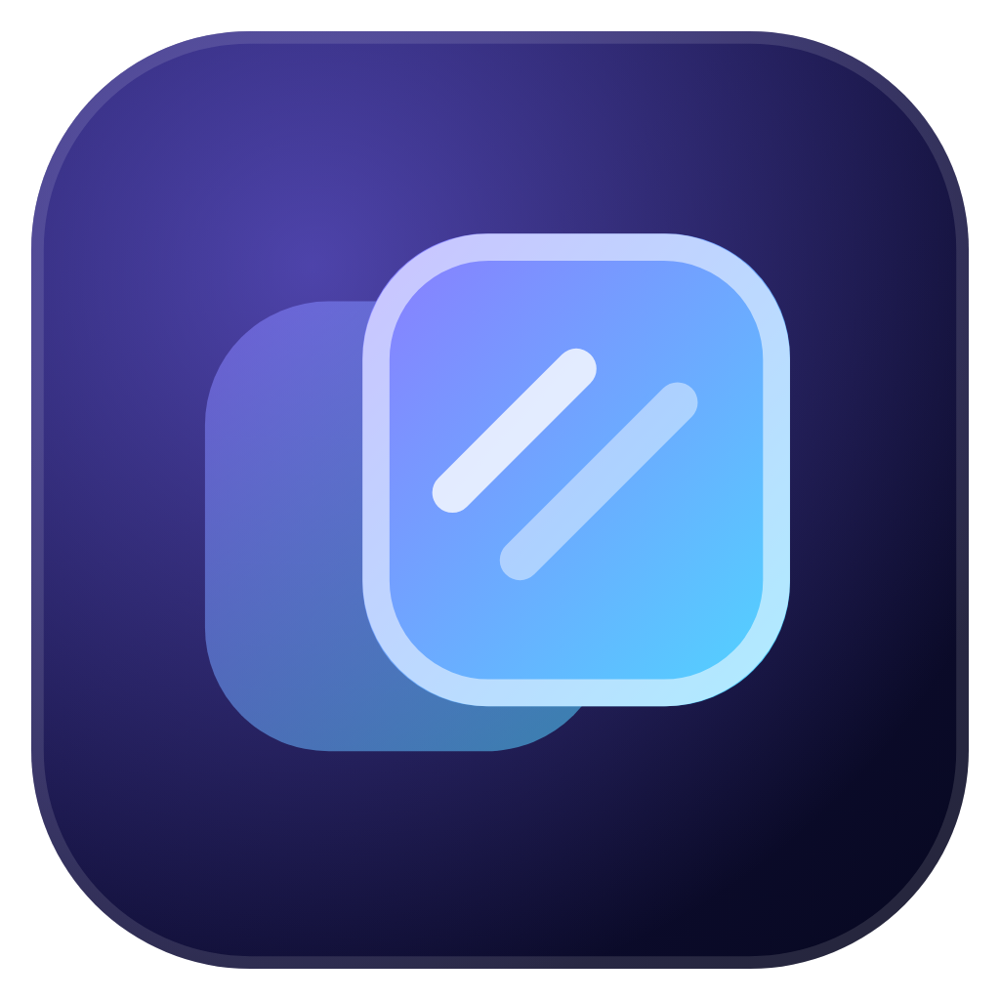
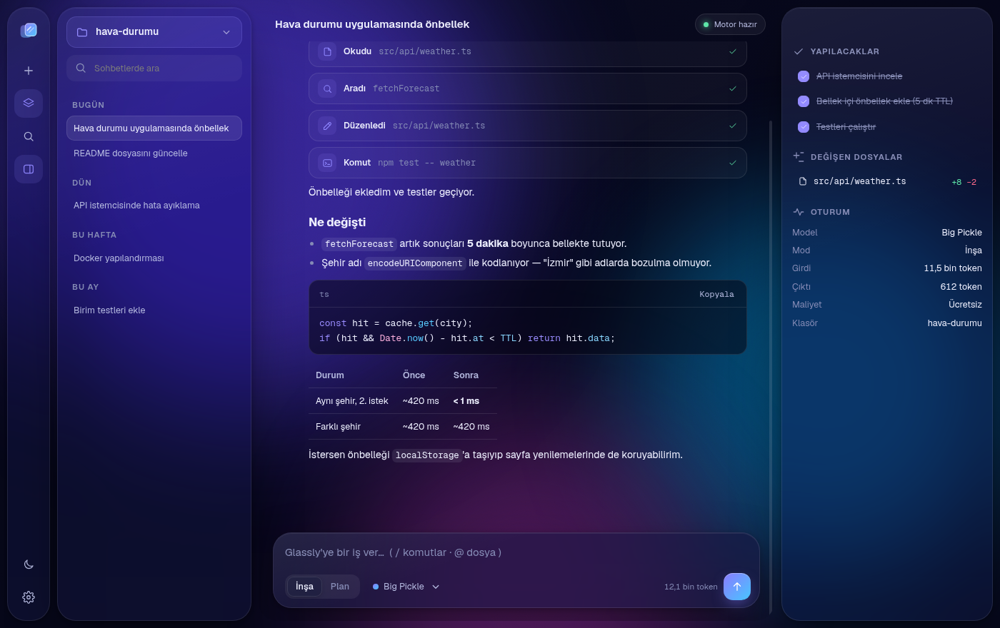
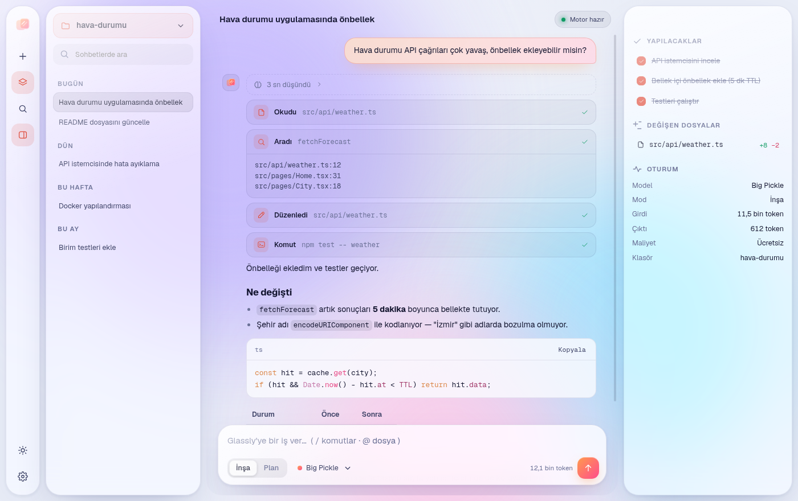

<p align="center"></p>

<h1 align="center">Glassly</h1>
<p align="center">Cam gibi berrak, açık kaynak AI kod asistanı. Motoru <a href="https://github.com/sst/opencode">opencode</a>.</p>



## Özellikler

- **Glassly hesabı**: ilk açılışta kaydol veya giriş yap. "Google ile devam et" tek tıkla hem hesabı açar hem Gmail, Takvim ve Drive'ı bağlar. Glassly Bulut ayarlıysa hesaplar sunucuda tutulur (her bilgisayardan aynı hesap); değilse bu bilgisayarda. Şifreler scrypt ile özetlenir, açık hâliyle saklanmaz. Ayarlar → Hesap bölümünden ad, şifre, çıkış ve hesap silme. Her hesabın Google ve GitHub bağlantıları, sohbetleri, hafızası ve hatırlatıcıları kendine aittir; aynı bilgisayardaki başka bir hesaba geçmez. Hesaplardan önceki sürümde yapılan bağlantılar hiçbir hesaba devredilmez, yeniden bağlanır.
- **Cam arayüz**: Aurora (koyu) ve Frost (açık) temalar, 5 vurgu rengi, hareketli arka plan, ayarlanabilir bulanıklık.
- **Ücretsiz modeller**: OpenCode Zen'in ücretsiz modelleri (Big Pickle vb.) model seçicide en üstte. Anahtar gerekmez.
- **Kendi anahtarın**: Anthropic, OpenAI, Google, OpenRouter ve diğer sağlayıcılar. OpenAI uyumlu özel sağlayıcı (Ollama, LM Studio vb.) da eklenebilir.
- **İnşa / Plan modları**: Plan modunda model dosyalara dokunmaz, sadece plan çıkarır.
- **Canlı akış**: düşünme adımları, araç kartları (okudu, aradı, düzenledi, komut), satır satır diff.
- **İzinler**: dosya düzenleme, komut çalıştırma ve web erişimi için "sor / izin ver / reddet". İstenirse tam otomatik mod.
- **Görev paneli**: yapılacaklar listesi, değişen dosyalar, token ve maliyet bilgisi.
- **Komutlar ve dosya etiketleme**: `/` ile komutlar, `@` ile projeden dosya ekleme.
- **Komut paleti**: `Ctrl/⌘ + K`.
- **Yetenekler (skills)**: Türkçe hazır yetenekler (Türkçe yanıt, git commit, kod inceleme, proje tanıtımı). Uygulama içinden düzenlenebilir.
- **Otomatik model değişimi**: bir model limite takılırsa Glassly onu geçici olarak kilitler, sıradaki ücretsiz modele geçer ve yanıtı kaldığı yerden sürdürür. İstersen her mesajda modeller arasında dönüşümlü de kullanabilir (Ayarlar → Modeller).
- **Glassly Bulut**: kendi sunucunda çalıştırdığın model havuzu (`server/`). Birçok sağlayıcıyı ve anahtarı tek adreste toplar, limit dolanı atlayıp sıradakine geçer. Kullanıcılar hiçbir anahtar girmeden kullanır.
- **Günlük ve Kod sekmeleri**: Günlük sekmesi e-posta, plan, çeviri, özet gibi gündelik işler içindir; dosya düzenlemez, komut çalıştırmaz. Kod sekmesi proje klasörüyle çalışan kod asistanıdır.
- **Bağlantılar**: Gmail (ara, oku, özetle, taslak yaz, gönder), Google Drive (ara, oku, belge oluştur) ve GitHub (depolar, issue/PR, dosya, yorum). Gönderme ve oluşturma işlemlerinden önce onay penceresi çıkar. Özel MCP sunucuları da eklenebilir.
- **Tek asistan**: arayüz ve sohbet tek bir asistan olarak "Glassly" görünür; arka plandaki model değişimi sessizce yapılır.
- **Sesli konuşma**: mikrofonla yaz ya da sesli sohbet modunda konuş; Glassly yanıtı sesli okur. Ayarlar → Ses bölümünden mikrofon seçilir ve denenir. Sesli okuma önce Microsoft'un doğal Türkçe seslerini dener; ulaşılamazsa Google sesine, internet yoksa bilgisayardaki espeak-ng'ye geçer (`sudo apt install espeak-ng`). Ses yazıya bilgisayarında çevrilir (Whisper). Model ilk kullanımda bir kez indirilir.
- **Takvim**: Google Takvim'deki etkinlikleri listeler, yenisini ekler, siler (eklemeden ve silmeden önce sorar).
- **Hatırlatıcılar ve zamanlanmış işler**: "yarın 9'da hatırlat" veya "her sabah e-postalarımı özetle". Uygulama kapatılınca sistem tepsisinde çalışmaya devam eder, zamanı gelince bildirim gösterir.
- **Hafıza**: adın, tercihlerin gibi kalıcı bilgileri hatırlar. Ayarlar → Hafıza'dan görülür ve silinir.
- **Dosya ve görsel**: PDF, Word, metin dosyaları ve görseller sürükle bırak, yapıştır veya ataç ile eklenir.
- **Akıcı akış**: yanıt yazılırken sadece değişen kısım güncellenir; sayfa titremez, kaydırma zıplamaz.



## Çalıştırma (kendi bilgisayarında)

1. [Node.js](https://nodejs.org) LTS sürümünü kur (bir kez).
2. Zip'i bir klasöre çıkar.
3. Windows: `Glassly-Baslat.bat` dosyasına çift tıkla. macOS: `Glassly-Baslat.command`. Linux: `./glassly-baslat.sh`.

İlk açılışta paketler kurulur ve motor indirilir (birkaç dakika). Yeni bir sürümü eski klasörün üstüne açarsan başlatma dosyası eksik paketleri kendisi kurar.

Linux'ta Glassly açılmazsa (Ubuntu 23.10 ve sonrası), bir kez şunu çalıştır:

```bash
sudo chown root:root node_modules/electron/dist/chrome-sandbox
sudo chmod 4755 node_modules/electron/dist/chrome-sandbox
```

Başlatma dosyası bu durumu kendisi de fark eder ve uygulamayı yine açar.

Gmail, Drive ve GitHub bağlantıları: sol menüdeki fiş simgesi (Bağlantılar) ya da Günlük ekranındaki "Gmail'i bağla" düğmeleri.

## Kurulum

Gerekenler: Node.js 20+ ve internet bağlantısı (ilk açılışta opencode motoru indirilir).

```bash
npm install
npm start
```

İlk açılışta Glassly, işletim sistemine uygun `opencode` ikili dosyasını npm kayıt deposundan indirip uygulama veri klasörüne kurar. Bilgisayarda zaten `opencode` kuruluysa o da kullanılabilir. Motor, Ayarlar → Motor bölümünden güncellenebilir ya da yeniden başlatılabilir.

## Paketleme

```bash
npm run dist:win     # Windows (kurulum + zip)
npm run dist:mac     # macOS (dmg + zip)
npm run dist:linux   # Linux (AppImage + deb)
```

Çıktılar `release/` klasörüne yazılır.

## Glassly Bulut (sınırsıza yakın kullanım)

`server/` klasöründeki sunucuyu kendi alan adında çalıştır, sonra paketlemeden önce `resources/cloud.json` içine adresini yaz:

```json
{ "name": "Glassly Bulut", "url": "https://api.glaslly.biz/v1", "key": "" }
```

Ayrıntılar: [server/README.md](server/README.md).

## Bağlantılar: tek tıkla bağlanma

Kullanıcıların hiçbir ayar yapmaması için Google ve GitHub istemcilerini yayınlamadan önce bir kez pakete gömersin. Sonrasında kullanıcı sadece **Google ile bağlan** veya **GitHub ile bağlan**'a basar.

### Google (Gmail, Takvim, Drive)

1. [Google Cloud Console](https://console.cloud.google.com/) → yeni proje.
2. API Kitaplığı'ndan **Gmail API**, **Google Calendar API** ve **Google Drive API**'yi etkinleştir.
3. OAuth izin ekranı → Harici. Uygulama adı, logo ve gizlilik politikası adresini doldur.
4. Kimlik bilgileri → OAuth istemci kimliği → **Masaüstü uygulaması**.
5. İstemcinin JSON dosyasını indir. Glassly'de **Google ile bağlan**'a bas, açılan pencereye dosyayı bırak, “Uygulamaya göm” işaretli kalsın. Glassly dosyayı `resources/google-oauth.json` olarak kaydeder; bundan sonra paketlediğin sürümde herkes tek tıkla bağlanır. (Elle yapmak istersen `resources/google-oauth.json.example` dosyasını kopyalayıp doldurabilirsin.)

`profile` iki değer alır:

- `hafif`: e-posta gönderme, takvim ve sadece Glassly'nin açtığı Drive dosyaları. Bu kapsamlar "hassas" sınıftadır; Google doğrulaması gerekir ama yıllık güvenlik denetimi gerekmez.
- `tam`: gelen kutusunu okuma, özetleme ve tüm Drive. Gmail okuma ve tam Drive "kısıtlı" kapsamlardır; doğrulamaya ek olarak yıllık bağımsız güvenlik denetimi (CASA) ister.

Doğrulanmamış uygulama en fazla 100 kullanıcıyla çalışır ve girişte uyarı ekranı gösterir. Ayrıntılar: [doğrulanmamış uygulamalar](https://support.google.com/cloud/answer/7454865), [hassas kapsam doğrulaması](https://support.google.com/cloud/answer/13463817), [kısıtlı kapsam doğrulaması](https://support.google.com/cloud/answer/13807380), [Gmail kapsamları](https://developers.google.com/workspace/gmail/api/auth/scopes).

Gömülü dosya yoksa kullanıcı kendi istemcisini Ayarlar → Bağlantılar → Gelişmiş bölümüne yapıştırabilir.

### GitHub

1. GitHub → Settings → Developer settings → OAuth Apps → New OAuth App.
2. **Enable Device Flow** seçeneğini aç.
3. `resources/github-oauth.json` dosyasına `{"client_id": "..."}` yaz.

Kullanıcı Bağlan'a basınca kısa bir kod görür, tarayıcıda onaylar, bitti. Ayrıntılar: [GitHub cihaz akışı](https://docs.github.com/en/apps/oauth-apps/building-oauth-apps/authorizing-oauth-apps).

Her iki dosya da git'e eklenmez.

Belirteçler yalnızca bu bilgisayarda, işletim sisteminin şifreli deposuyla (safeStorage) saklanır. Araçlar uygulamanın içinde, sadece 127.0.0.1'den erişilebilen küçük bir MCP sunucusu üzerinden motora verilir.

## Kısayollar

| Kısayol | İşlev |
| --- | --- |
| `Ctrl/⌘ + N` | Yeni sohbet |
| `Ctrl/⌘ + O` | Klasör aç |
| `Ctrl/⌘ + K` | Komut paleti |
| `Ctrl/⌘ + M` | Model seç |
| `Ctrl/⌘ + B` | Sohbet listesini aç/kapat |
| `Ctrl/⌘ + I` | Görev panelini aç/kapat |
| `Ctrl/⌘ + ,` | Ayarlar |
| `Esc` | Yanıtı durdur |

## Mimari

```
src/main/       Electron ana süreç
  engine.js     opencode motorunu indirir, `opencode serve` ile başlatır,
                HTTP + SSE (/global/event) ile konuşur
  main.js       pencere, IPC, dosya/klasör işlemleri
  store.js      ayarlar (glassly.json)
  preload.js    arayüze güvenli `window.glassly` API'si
src/renderer/   arayüz (vanilla JS, derleme adımı yok)
resources/skills/  hazır yetenekler
tools/mock-engine.js  test için sahte opencode sunucusu
server/         Glassly Bulut: OpenAI uyumlu model havuzu (kendi sunucun)
```

Motor kendi yalıtılmış klasörlerinde (XDG) çalışır, sadece `127.0.0.1` üzerinde dinler ve her açılışta rastgele bir parola ile korunur. Bilgisayarındaki diğer opencode kurulumlarına dokunmaz.

## Geliştirme

Gerçek model kullanmadan arayüzü denemek için sahte motor:

```bash
npm run mock
# başka bir terminalde
GLASSLY_ENGINE_URL=http://127.0.0.1:4777 npm start
```

Windows PowerShell için: `$env:GLASSLY_ENGINE_URL="http://127.0.0.1:4777"; npm start`

Ayrıntılı motor günlüğü için `GLASSLY_DEBUG=1` kullan.

## Lisans

MIT. opencode, [SST](https://github.com/sst/opencode) tarafından MIT lisansıyla geliştirilmektedir.

> Not: `src/renderer/vendor/transformers.min.js` depoda sıkıştırılmış (`.gz`) olarak durur. Yerelde çalıştırmadan önce: `gunzip -k src/renderer/vendor/transformers.min.js.gz`
